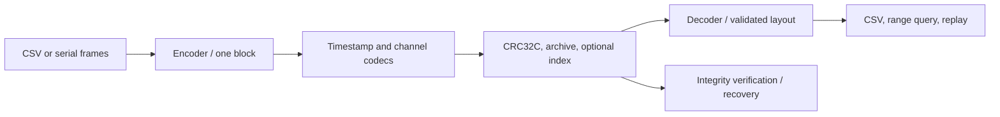

# Architecture

The library borrows C stdio streams and stores one bounded block at a time.
The writer uses a fixed schema and starts a new predictor state per block.
For an indexed update stream, finishing the archive scans block headers in
batches of 64 entries and appends the index. An unindexed writer emits
blocks and a footer sequentially. A single writer produces one new archive.
The current API has no append-to-finalized-file operation.

Opening a decoder is linear in the number of block headers. It validates the
footer, checks each header and verifies the optional index against those
headers. It does not decompress payloads during this step. An indexed seek
binary-searches block end times, including ties across blocks. An unindexed
seek scans headers. Queries load and check selected block payloads and emit
only rows in the inclusive range. `verify` decodes every block.

For 32 channels the context holds approximately 274 KiB of decoded rows and
encoded bytes. The encoder additionally uses under 165 KiB of temporary
stack storage while selecting a representation. Recovery owns one encoder
and one decoder-sized workspace together. These are implementation storage
bounds excluding stdio buffers and process/runtime overhead. Index size,
archive length and CSV row count do not grow decoder heap usage. Commands
stream output, so the number of result bytes depends on the selected rows.
Use a stable input file for the lifetime of each context.
